<p align="center">
  
</p>

<h1 align="center">DualWave</h1>
<p align="center">Native Linux configuration and Bluetooth audio for DualSense controllers</p>
<p align="center">
  <a href="#getting-started">Installation</a> ·
  <a href="#features">Features</a> ·
  <a href="#inside-the-app">Screenshots</a> ·
  <a href="#distribution">Distribution</a> ·
  <a href="#building">Build</a> ·
  <a href="https://github.com/jpbjesus/dualwave/issues">Issues</a>
</p>

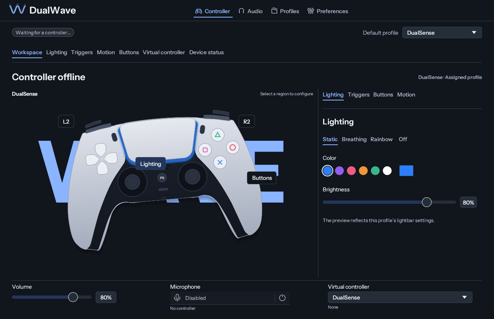

DualWave is a native desktop application for configuring DualSense and DualSense
Edge controllers on Linux. It provides adaptive trigger effects, lightbar
configuration, input mappings, motion controls, virtual controllers and profiles.
For a standard DualSense connected over Bluetooth, it also provides headphone
playback and microphone capture through PipeWire.

The project is an independent fork of [DSZ](https://github.com/MaximumFreak/dsz).
The current source integrates DSZ 0.4.2, including profiles active while a
button is held, experimental DualShock 4 Bluetooth audio and a virtual microphone
alongside Xbox 360 and DualShock 4 output. DualWave
retains its Linux backends, interface and European Portuguese translations.

**Status:** alpha. Availability in the interface does not imply validation on
every controller, firmware, Bluetooth adapter or game. See
[Compatibility](#compatibility) for the tested paths and current limitations.
The latest published package may precede changes shown in this source README;
consult its release notes before downloading.

## Features

| Feature | Configuration |
| --- | --- |
| Lighting | Static and animated lightbar effects, audio response, brightness, player LEDs and mute indicator |
| Adaptive triggers | Independent L2/R2 resistance, release points, vibration and per-zone effects |
| Headphone audio | Bluetooth stereo playback through the 3.5 mm jack, routing and volume |
| Microphone | Built-in, headset or automatic source; gain, capture permission, mute and physical Mute button |
| Haptics | Game and system audio, button feedback, trigger texture and rumble conversion |
| Input mappings | Keyboard, mouse and controller actions; combinations, long press, double tap and suppression of original virtual buttons |
| Motion and touch | Gyro aiming, touchpad mouse control, stick modes, activation buttons and activation by touching a touchpad third |
| Stick calibration | Per-direction reach adjustment at 16 angles, guided calibration and a preview applied only to virtual stick output; disabled by default |
| Virtual output | Xbox 360, DualSense and DualShock 4 targets through Linux USB/IP |
| Upstream 0.4.2 | Hold a button to use another profile without reconnecting the virtual pad; experimental DualShock 4 Bluetooth audio (off by default); virtual microphone alongside Xbox 360 and DualShock 4 output. Hardware validation pending |
| Profiles and games | Executable associations, process discovery, automatic switching, manual session priority, import/export and backups; DualWave excludes its own executable and AppImage from native-game detection |
| Integrations | Local DSU motion server and UDP mod API |
| Interface | Direct controller-region selection, vector button symbols, English, European Portuguese, Brazilian Portuguese and Spanish; light/dark/system appearance and reduced motion |
| Desktop integration | Tray, startup preferences and device naming |
| Diagnostics | Connection state, automatic media recovery, endpoint recreation and a sanitized diagnostic report |

## Inside the app

### Controller workspace

Select a trigger, touchpad or face button in the preview to open its controls.
L2/R2 are separated from the shoulder buttons; the PlayStation symbol is drawn
as an outline. The adjacent tabs provide lighting, trigger, button and motion
controls. Playback volume, microphone state and virtual output are below the
preview.

The main navigation contains **Controller**, **Audio**, **Profiles** and
**Preferences**. Controller tabs provide access to the complete editors and
connection diagnostics.

### Lighting

The workspace provides static, breathing and rainbow effects. The full editor
adds strobe, battery and audio response, player LEDs and mute indicator settings.
The preview reflects the profile being edited.

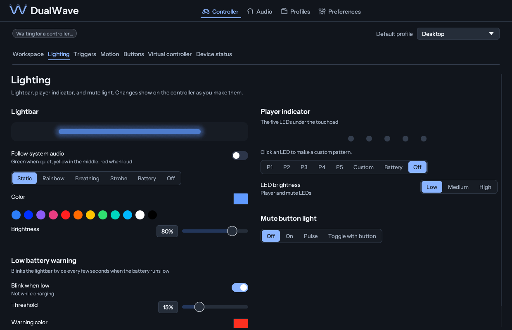

### Adaptive triggers

Configure one trigger or both using resistance presets, firing points, vibration
and per-zone parameters. The workspace simulation changes the preview only; it
does not transmit an effect to the controller.

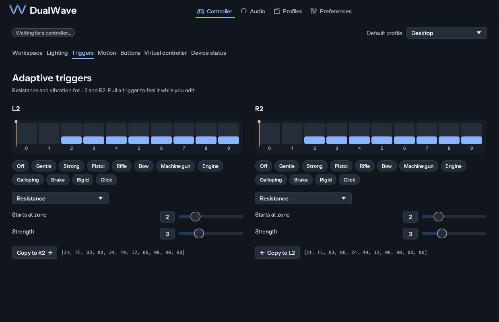

### Button mappings

Assign press, long-press and double-tap gestures to keyboard, mouse or controller
actions. Combinations and timing are configured in the full editor. An individual
mapping can suppress its original virtual button. The Workspace uses the same
action editor as the complete mapping page, including key capture, modifiers,
mouse/media buttons, profile changes, program paths and virtual buttons. Opening
the editor does not create a mapping until an action is changed.

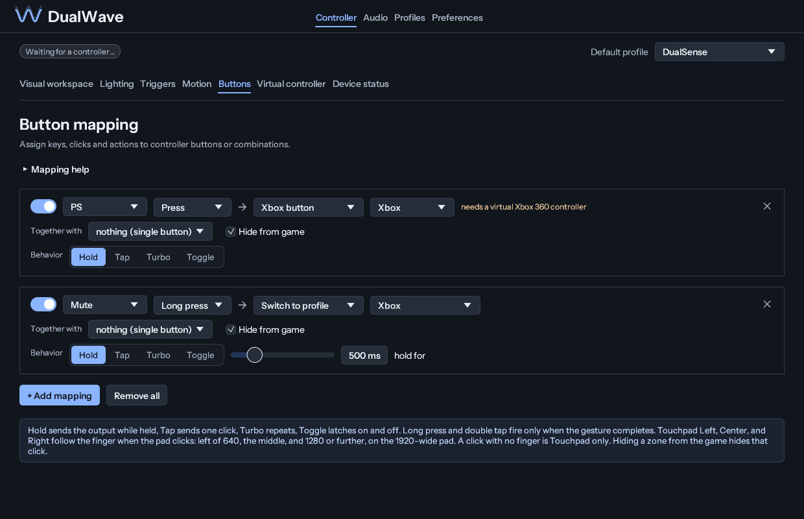

### Motion and touchpad activation

Configure gyro aiming, touchpad interaction and stick modes in **Motion**.
Gyroscope activation supports a held button, an unheld button, a toggle, or touch
within the left, centre or right third of the touchpad. **While touching** requires
finger contact only; it does not require pressing the touchpad.

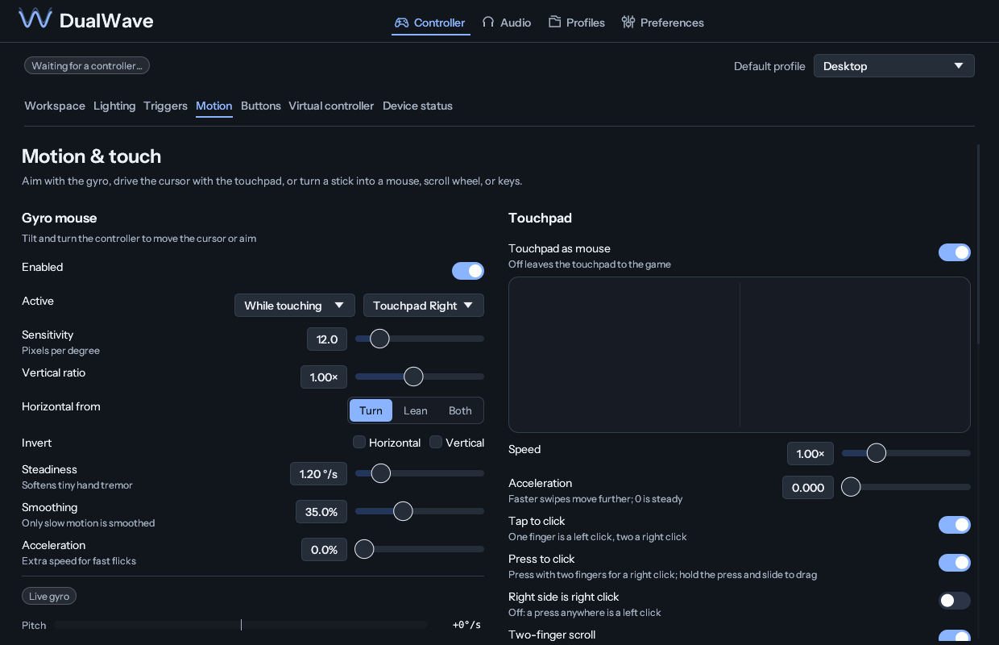

### Directional stick reach

The **Sticks** section of **Motion** provides a separate 16-direction reach curve
for each stick. Calibration measures the outer range during three complete
rotations and presents a proposal for review. Apply accepts it; Discard retains
the existing configuration. Missing measurements retain their existing gains.

Reach adjustment is disabled by default. When enabled, it applies after axis
inversion and before the existing deadzone processing, only to passthrough stick
input sent to a virtual controller. Mouse, scroll and keyboard stick modes retain
their existing behaviour. An offline preview displays the editor but cannot
measure a physical controller.

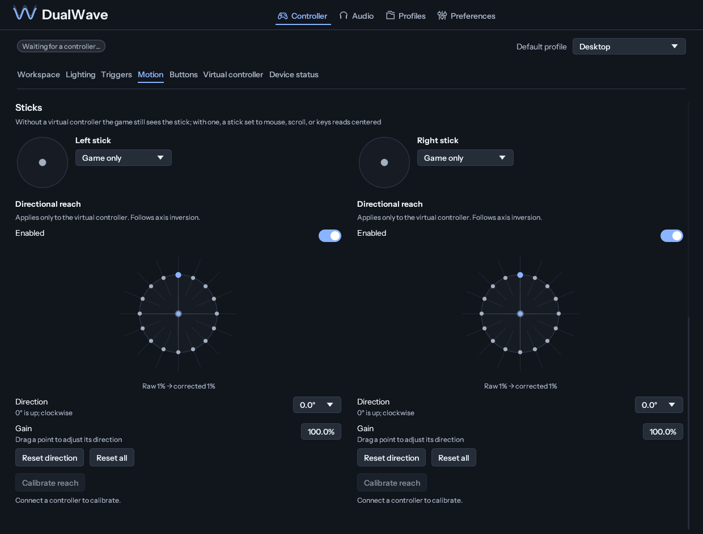

### Playback and microphone

**Audio** opens playback and microphone controls. Select a microphone source,
adjust gain and manage capture permission separately from mute. Disabling
capture preserves the saved mute state.

Capture is disabled by default. Enabling it makes the source available to a
recording application; DualWave does not save recordings. The level indicator
uses microphone samples only while an application is recording. The physical
Mute button can control recording when enabled in the profile.

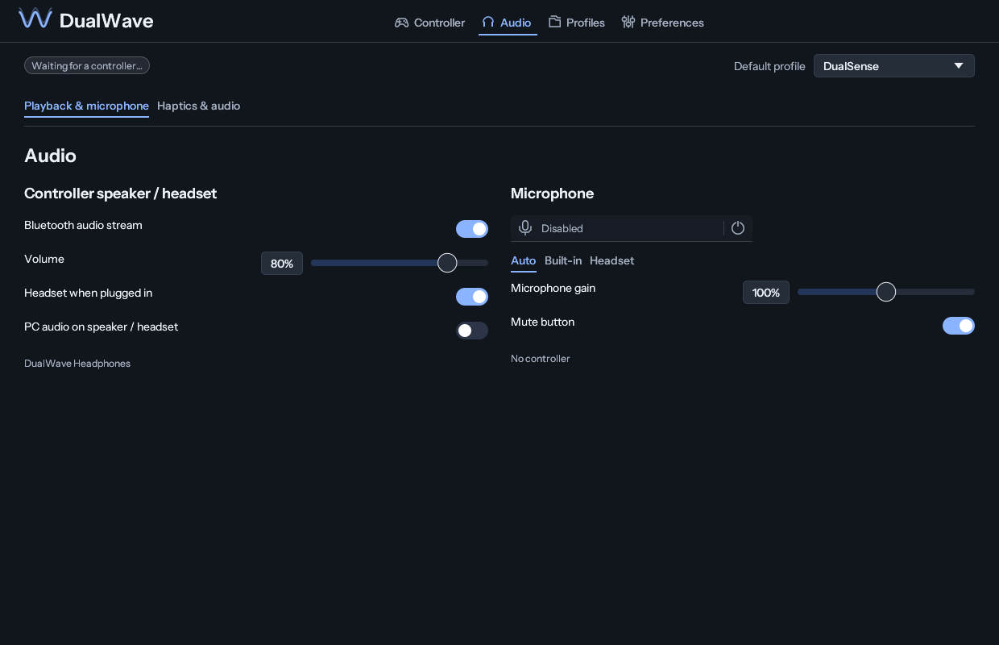

### Haptic feedback

**Haptics & audio** provides playback routing, audio-derived haptics, rumble
conversion, button feedback and trigger texture settings.

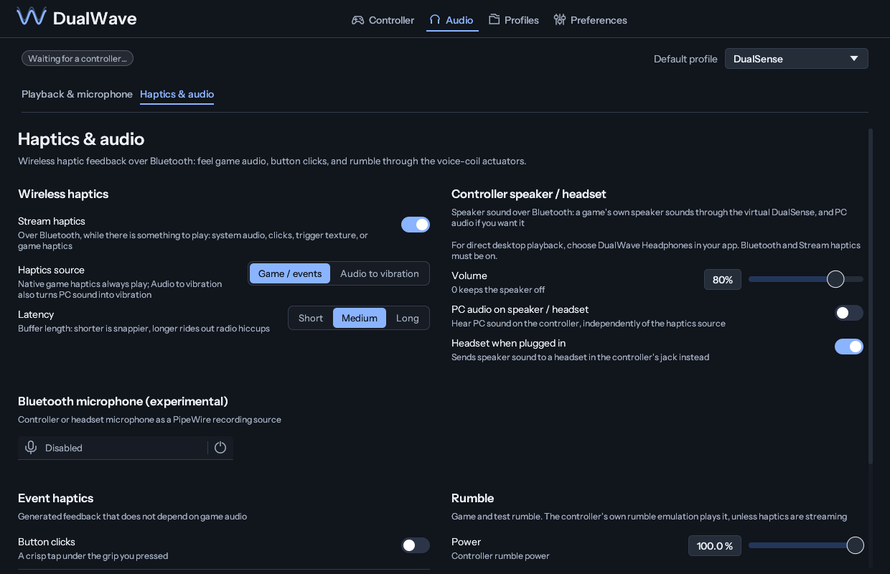

### Virtual controllers

Select an Xbox 360, DualSense or DualShock 4 target in **Virtual controller**.
Mappings and stick calibration apply to virtual output. The page reports the
requested target separately from the active device and provides host-support
configuration. Game and host-attachment validation remains pending.

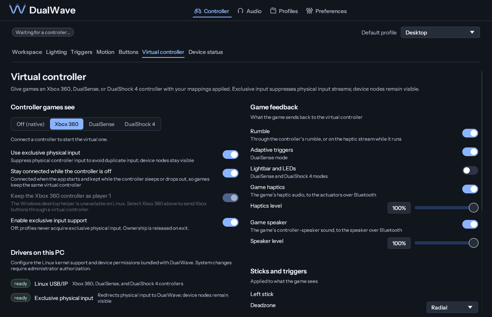

### Profiles and automatic selection

Create, duplicate, rename, import and export profiles. Selecting a profile for
editing does not apply it to a connected controller; edits are saved
automatically. **Backup & restore** exports settings and profiles together.
Profile names and saved identifiers are independent of the interface language.

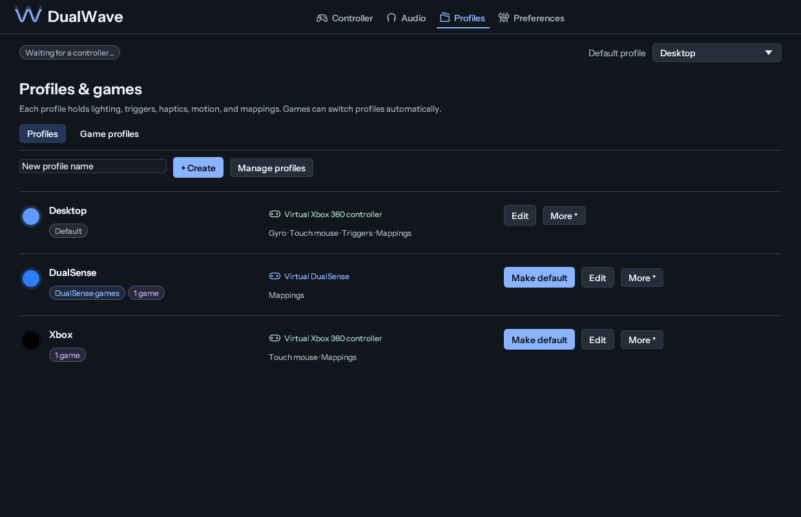

**Profiles → Game profiles** lists detected games and executable associations,
including resolved Wine/Proton executables. Add a running application or browse
for an executable to configure a rule. Association does not enable automatic
switching by itself.

When automatic switching is enabled, the most recently started eligible game
takes priority. Closing it returns to the next eligible game or the assigned
profile. A manual profile choice takes priority for the affected game session,
including detection already in progress. Closing those process instances clears
the manual override. Rules targeting missing profiles are not applied.

DualWave excludes its own executable and AppImage from native DualSense-game
detection, including previously cached positive results. Selection reasons are
available in the profile header.

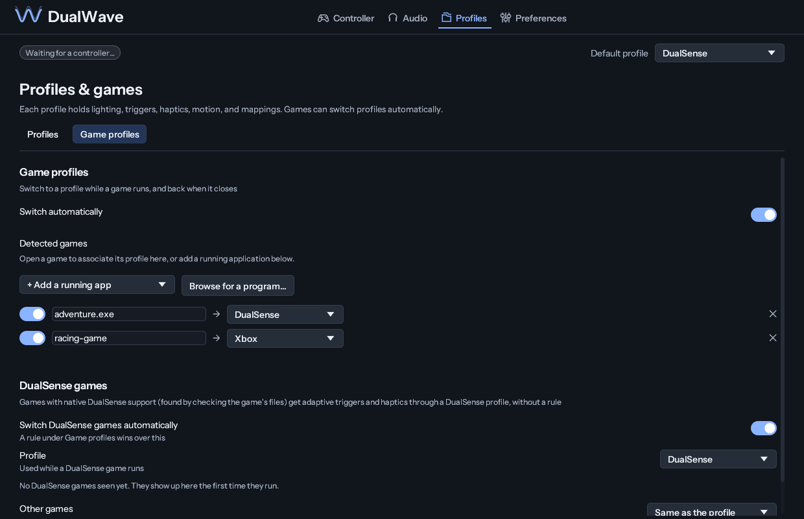

### Connection diagnostics

**Controller → Device status** displays physical connection, Bluetooth media
support, playback and microphone endpoints, virtual output and applied profile.
Availability and active use are reported separately.

**Reconnect audio** requests endpoint recreation without enabling microphone
capture or changing mute. Automatic recovery handles stale controller sessions,
media-channel loss and PipeWire server disconnection. Audio applications may
need to select a recreated endpoint again. Recovery does not pair or power on a
controller.

**Copy diagnostic report** copies a technical summary without device addresses,
paths, profile names, raw error messages or audio samples. If media support is
missing, the AppImage's system setup remains an explicit action; a reboot is
required after installing the driver.

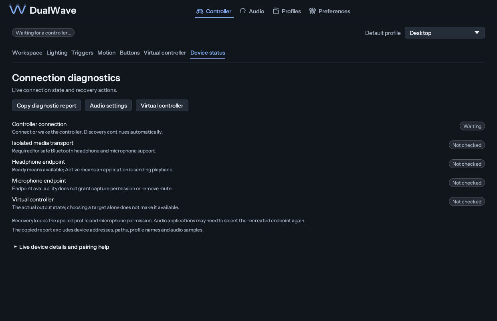

### Preferences and languages

Preferences groups appearance, language, startup, controller settings,
integrations, backups and logs. English, Portuguese (Portugal), Portuguese
(Brazil) and Spanish are available. Changing language does not rename profiles
or change saved controller settings.

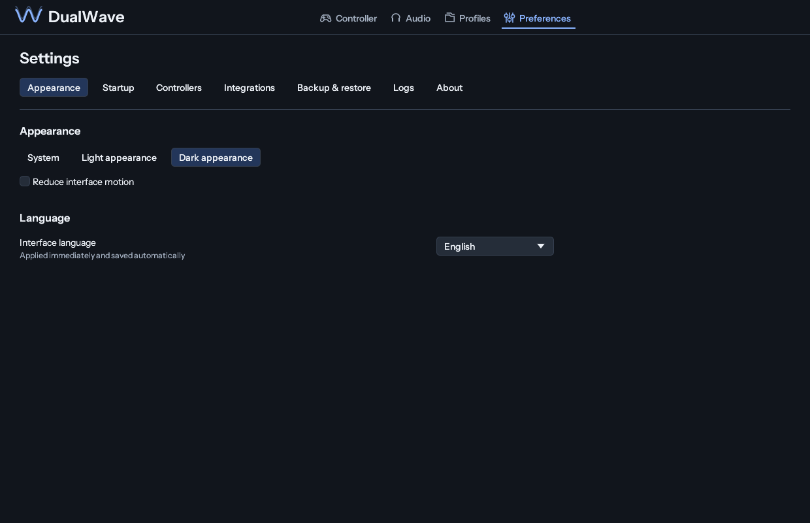

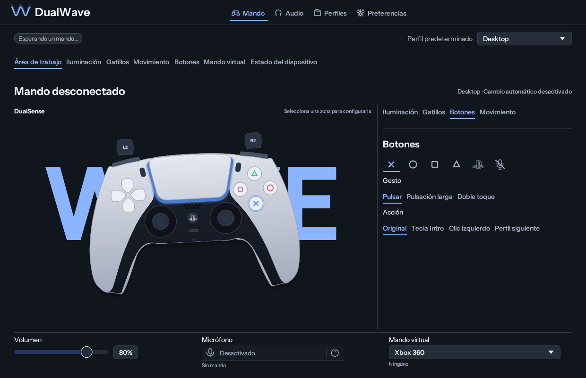

These captures are generated from the native debug application with isolated
example settings and no controller connected. They document the interface and
are not evidence of hardware validation. Calibration cannot be performed from
an offline preview.

## Getting started

Download the AppImage and its SHA-256 manifest from
[Releases](https://github.com/jpbjesus/dualwave/releases). Verify the checksum,
make the file executable and run it:

```sh
sha256sum -c DualWave-x86_64.AppImage.sha256
chmod +x DualWave-x86_64.AppImage
./DualWave-x86_64.AppImage
```

1. On CachyOS, complete the first-run system setup when requested. Administrator
   authorization installs the bundled DKMS/device support and matching kernel
   headers. This step requires `kdialog` and `polkit`.
2. Reboot after installing system support, then reconnect the controller over
   Bluetooth and open DualWave.
3. Connect headphones before starting playback. Select **DualWave Headphones**
   in the desktop or application's audio output settings.
4. To record, enable microphone capture in DualWave and select
   **DualWave Microphone** in the recording application.

Normal operation runs as the desktop user. System installation is separate from
application startup. The published alpha.1 setup targets CachyOS; the current source adds experimental
portable host setup as described below.

## Distribution

| Format | Status | Scope |
| --- | --- | --- |
| AppImage | Published for Linux x86_64 | GUI, audio CLI, userspace libraries and source-only host-support package |
| Native binary archive | Build implemented; local source build and manual release workflow | GUI, CLI, licenses, desktop launcher, dependency manifest and separate host setup payload |
| Flatpak | Under evaluation; no package or Flatpak repository is provided | Requires validation of HID access, uinput, process discovery, PipeWire and communication with the host USB/IP broker |
| `curl` installation | Source installer implemented; requires an explicit release version | Verifies the selected asset before activation, installs as the desktop user, supports dry run and managed uninstall |

Example download for the published 0.4.1 alpha release:

```sh
release=v0.4.1-alpha.1
release_url="https://github.com/jpbjesus/dualwave/releases/download/$release"
curl -fL --output DualWave-x86_64.AppImage "$release_url/DualWave-x86_64.AppImage"
curl -fL --output DualWave-x86_64.AppImage.sha256 "$release_url/DualWave-x86_64.AppImage.sha256"
sha256sum -c DualWave-x86_64.AppImage.sha256
chmod +x DualWave-x86_64.AppImage
```

The source installer requires Python 3.12 or newer, downloads through HTTPS,
checks the release's SHA-256 manifest and activates the installation atomically.
It never installs drivers or changes system permissions. Existing settings are
preserved; unrelated launchers and unmanaged directories are not overwritten.

```sh
curl -fL --output install-dualwave.sh https://raw.githubusercontent.com/jpbjesus/dualwave/linux-port/packaging/install.sh
sh install-dualwave.sh --version v0.4.1-alpha.1 --dry-run
sh install-dualwave.sh --version v0.4.1-alpha.1
# For a release that includes a native archive:
sh install-dualwave.sh --version v0.4.1-alpha.1 --format native --dry-run
# Remove only this installer's files; profiles and settings remain:
sh install-dualwave.sh --uninstall
```

The published alpha.1 release contains the AppImage. Native archives and the new
host setup payload are available from this source revision and must be attached
to a subsequent release before `--format native` can download them. Build locally:

```sh
python3 packaging/build-binaries.py
mkdir -p /tmp/dualwave-native
tar -xzf target/binaries/DualWave-linux-x86_64.tar.gz -C /tmp/dualwave-native
/tmp/dualwave-native/bin/dualwave --plan
```

The [manual native archive workflow](.github/workflows/native-binaries.yml) builds
on Ubuntu 24.04 and uploads artifacts to an explicitly selected existing release.
A local build inherits the build host's glibc requirement; `dependencies.json`
records the libraries and build libc. No cross-distribution binary compatibility
is implied by the installer detecting a distribution.

### Host setup beyond CachyOS

Source-built AppImages and native archives include a separate, checksummed host
support payload. `dualwave --plan` prints the distribution, kernel and commands
without changing the system. `dualwave --setup` explicitly requests administrator
authorization. Arch derivatives use kernel package metadata for matching headers;
Debian/Ubuntu use `linux-headers-$(uname -r)`; Fedora uses the matching
`kernel-devel` package. Package availability and module API compatibility must
still be established on each target system.

The portable setup builds the bundled module with DKMS before installing the
host configuration. It does not unload modules, restart desktop audio or replace
a running controller session. Reboot afterwards. Secure Boot may require key
enrolment. Outside the existing CachyOS integration, these paths are experimental;
unit tests of dependency selection are not hardware or distribution certification.
The DKMS [manual](https://github.com/dkms-project/dkms/blob/main/dkms.8.in)
describes module build and install operations.

Flatpak packaging remains outside this implementation. It cannot replace host
kernel support, and its device permissions and broker integration require a
separate assessment.

## Compatibility

The current native port targets Linux with PipeWire. CachyOS is the primary
integration environment. Portable source-based setup for other distributions is
experimental and has not been certified through installation or hardware tests.
The following table distinguishes available code from hardware validation.

<details>
<summary>Implementation and hardware validation by feature</summary>

“Implemented” describes the code available in this fork; it does not imply every
controller, Bluetooth adapter or game has been tested.

| Feature | Available controls | Validation |
| --- | --- | --- |
| Controller workspace | Native controller preview, contextual configuration, quick volume/microphone/output controls and actual device status | Native rendering and layout tests |
| Recovery and diagnostics | Media-channel reattachment, stale-session retirement, queued audio retry and sanitized clipboard report | Unit/UI checks and isolated PipeWire daemon restart test; Bluetooth/suspend hardware scenarios pending |
| Lighting | Static, rainbow, breathing, strobe, battery/audio response, player LEDs and mute LED | Original core retained; integrated Linux hardware checks pending |
| Adaptive triggers | Visual presets and full resistance, weapon, vibration and per-zone editors for L2/R2 | Original protocol retained; integrated hardware checks pending |
| Bluetooth headphone audio | Stereo through the jack, speaker/headset routing, hardware volume and PipeWire playback endpoint | Earlier CLI/filter confirmed on standard DualSense, firmware 6.30; current GUI/isolation path needs validation |
| Bluetooth microphone | Built-in/headset/automatic source, gain, mute, physical Mute button and PipeWire recording endpoint | Earlier CLI/filter confirmed; current integrated path needs validation |
| Haptics | Game audio, system audio, button clicks, trigger texture and rumble conversion | Original encoder/core retained; Linux integration needs hardware checks |
| Mappings and motion | Keys, mouse, controller buttons, gestures, gyro activation by touchpad zone, touchpad and stick modes | Native uinput backend implemented; hardware validation pending |
| Directional stick reach | Independent 16-direction gains, guided calibration and virtual-output preview; disabled by default | Exhaustive neutral-position checks, saved-profile round trips and unchanged-report fixture; physical calibration validation pending |
| Virtual controllers | Xbox 360, DualSense and DualShock 4 over native Linux USB/IP, with scoped privileged broker | Host attachment and game compatibility validation pending |
| Exclusive physical input | Scoped evdev grabs and kernel raw-state redirection; device nodes remain visible | Routing/build tests; hardware validation pending |
| Upstream 0.4.2 | Hold a button to use another profile without reconnecting the virtual pad; experimental DualShock 4 Bluetooth audio (off by default); virtual microphone alongside Xbox 360 and DualShock 4 output. Hardware validation pending |
| Profiles and games | Detected-game association, per-game rules, start-time priority, manual session priority, selection reasons and Wine/Proton process discovery | Selection lifecycle, relaunch, duplicate-rule, pointer interaction and layout tests; real game sessions pending |
| Integrations | Local UDP mod API and DSU motion server for supported emulators | Implemented; game/emulator integration checks pending |
| Desktop integration | StatusNotifier tray, XDG autostart, bundled fonts, themes and motion preferences | Native implementation; desktop-dependent tray behavior |
| System support | Source-only DKMS package, device permissions and AppImage first-run setup | Package/build checks; first-install/reboot flow needs end-to-end validation |

</details>

### Devices and current limits

- **Primary audio target:** standard DualSense over Bluetooth (`054c:0ce6`).
  Do not assume Bluetooth audio support for Edge, DualShock 4 or clone devices
  from their controller-input support alone.
- Headphones must be connected before playback starts. Headset microphone
  selection after reinsertion, reconnect behavior and simultaneous Steam/game
  use need further validation.
- USB audio uses the controller's existing USB audio device, outside this
  Bluetooth bridge.
- AppImages are built against the build host's glibc/graphics stack. Compatibility
  with older distributions is not claimed. Other PipeWire Linux systems can
  build from source, but automatic system configuration is CachyOS-specific.
- Windows Game Bar and Windows default-audio-role management have no Linux
  counterpart. DualWave preserves PipeWire session policy.

## Building

Install a Rust toolchain, a C/C++ build toolchain, and the PipeWire and Opus
libraries with development headers using your system's package manager. Build
as a normal user:

```sh
cargo build --release --locked -p dsz -p dualwave
```

<details>
<summary>Dependency example: CachyOS / Arch Linux</summary>

```sh
sudo pacman -S --needed base-devel rust pipewire libpipewire opus
```

Package names and system integration differ between distributions.

</details>

- `target/release/dsz` — native GUI.
- `target/release/dualwave` — audio diagnostic CLI.

Build an AppImage with an official
[appimagetool](https://github.com/AppImage/appimagetool) executable:

```sh
python3 packaging/appimage/build.py --appimagetool /path/to/appimagetool
```

Output: `target/appimage/DualWave-x86_64.AppImage`, with a SHA-256 manifest and
bundled source-only `dualwave-hid-dkms` package. Package verification commands:

```sh
./DualWave-x86_64.AppImage --check       # Verify the bundled driver payload
./DualWave-x86_64.AppImage --plan        # Inspect setup without installing
./DualWave-x86_64.AppImage --cli list    # Read-only controller discovery
```

### Settings and profiles

Normal Linux settings live under `$XDG_CONFIG_HOME/dualwave`, or
`~/.config/dualwave` when `XDG_CONFIG_HOME` is unset. Profiles are in its
`profiles` subdirectory. **Preferences → Backup & restore** exports or restores
all profiles and application settings together; a restore first saves the
previous configuration.

Selecting a profile to edit does not silently apply it to a connected controller.
Changes to the edited profile are saved automatically. Profile names and saved
identifiers remain independent of the interface language.

### Diagnostics and system support

<details>
<summary>Audio CLI and controller isolation</summary>

```sh
cargo run -p dualwave -- list
cargo run -p dualwave -- probe
cargo run -p dualwave -- tone --seconds 10 --volume 60
cargo run -p dualwave -- mic-probe --source headset --seconds 10
cargo run -p dualwave -- run --source auto --volume 60
```

`list` reads sysfs; `probe` reads status and a CRC-checked firmware feature report.
`pipewire-probe --seconds 10` exposes endpoints without opening or writing to a
controller. `tone`, `mic-probe` and `run` explicitly start their corresponding
sessions. Source choices are `auto`, `builtin` and `headset`; `--seconds N` bounds
a session. Ctrl+C/SIGTERM stops streaming and disables microphone admission.

The current driver exposes a receive-only **DualWave Microphone Transport** HID
child. It validates the Bluetooth CRC, keeps state reports on the gamepad and
routes microphone reports to that child before HID core publishes them to raw
controller readers. The child identity and ancestry are checked before use.

Without the child, legacy audio mode requires Steam to be closed and temporarily
grabs the controller's evdev devices. It is unsuitable for gameplay during audio.
The first tested state-parser filter alone does not isolate microphone packets
from raw-HID game clients. Close other controller tools before audio probes.

No controller firmware is flashed, and the driver does not start an audio stream
on its own. Source provenance and the patch are under `packaging/kernel/`.
`dualwave_audio` defaults to off in the module; the DKMS package opts in. Its
read-only `dualwave_mic_muted` attribute preserves physical-mute synchronization.
Long-running clock drift, adapter compatibility and forced-crash cleanup still
need production validation; reconnect after forcibly terminating a session.

</details>

<details>
<summary>DKMS packaging, device access and removal</summary>

```sh
python3 packaging/build-kernel-package.py
```

The source-only package is staged in `target/packages/dualwave-hid-dkms/` and
includes scoped udev rules, a `dualwave` group for uinput/USB-IP broker access,
and systemd socket units. The AppImage's setup installs missing matching headers,
runs package hooks and enables the broker for the next boot. It does not replace
a loaded controller module during an active session.

The sources have compiled against `7.2.9-2-cachyos` and
`6.18.55-2-cachyos-lts`; future kernel compatibility still depends on a successful
DKMS build and matching headers. The USB/IP broker tracks local ownership and
releases imported virtual ports when clients exit. After a broker restart,
restart the application's virtual controller rather than adopting a busy port.

The manual development udev rule is `packaging/70-dualwave.rules`. Reconnect after
installing/reloading it. Do not run DualWave as root or add the user to the global
`input` group; access is scoped to the active local seat and supported device.

To return to the stock controller module:

```sh
sudo pacman -R dualwave-hid-dkms
sudo mkinitcpio -P
```

Reboot afterwards. A manually installed
`/etc/udev/rules.d/70-dualwave.rules` is separate from the packaged rule under
`/usr/lib/udev/rules.d/`; remove that manual copy too if undoing device access.

</details>

## Development and verification

```sh
cargo test --workspace --locked
cargo clippy -p dualwave --all-targets --locked -- -D warnings
python3 -m unittest discover -s packaging/tests -v
cc -std=c11 -Wall -Wextra -Werror packaging/kernel/test-routing.c -o /tmp/dualwave-routing-test
/tmp/dualwave-routing-test
```

Linux CI also runs the concurrent PipeWire ring-buffer tests with address and
undefined-behavior sanitizers. Upstream Windows/MSVC integrations require their
own checks; a Linux build does not validate them.

The PipeWire restart integration test is opt-in and starts its own server. Run
it in a dedicated runtime directory to avoid affecting your desktop audio:

```sh
recovery_runtime=$(mktemp -d /tmp/dualwave-pipewire-recovery-XXXXXX)
env -u PIPEWIRE_REMOTE XDG_RUNTIME_DIR="$recovery_runtime" \
  PIPEWIRE_RUNTIME_DIR="$recovery_runtime" \
  cargo test -p dsz --locked isolated_pipewire_recovery -- --ignored
```

This test recreates endpoints after daemon loss and checks that capture stays
disabled. Physical Bluetooth reconnect, suspend/resume and recording-client
reselection still require hardware validation.

The Linux lifecycle harness runs profile/process tests and an isolated PipeWire
daemon restart. It emits a JSON report with separate `PASS`, `FAIL`, `SKIP` and
`MANUAL_PENDING` results; it never suspends the host, opens a controller or
launches a game:

```sh
python3 packaging/validate-linux.py --output /tmp/dualwave-validation.json
```

Physical Bluetooth reconnect, suspend/resume and named Steam/Proton game sessions
remain manual validation items. Record controller model, firmware, game and
runtime versions when performing those checks.

Debug builds support isolated, controller-free UI captures:

```sh
DSZ_DATA_DIR=/tmp/dualwave-preview \
DSZ_SNAPSHOT=/tmp/dualwave-controller.bmp \
DSZ_SNAPSHOT_SIZE=1240x800 \
  target/debug/dsz --page workspace
```

`DSZ_SNAPSHOT_PART` chooses `lighting`, `triggers`, `buttons` or `motion`.
`DSZ_SNAPSHOT_SECTION` selects a Preferences/Profile subpage, and
`DSZ_SNAPSHOT_BOTTOM=1` captures the end of a long editor. These switches are
for debug snapshots only; they do not open controllers or start the audio engine.

| Path | Responsibility |
| --- | --- |
| `crates/ds-proto` | Controller protocol, CRCs, reports and trigger effects |
| `crates/dsz` | Native application, profiles, device workers and Linux backends |
| `crates/dsz/src/ui` | Native egui views, navigation, widgets and theme |
| `crates/dualwave` | Standalone PipeWire/audio diagnostics |
| `packaging` | AppImage, DKMS sources, permissions, broker and system setup |
| `vendor` | Patched eframe and bundled libopus sources |
| `.github/screenshots` | Reproducible captures of the native UI |

## Credits and licenses

DualWave preserves DSZ's original history and MIT notice. Thanks to
[MaximumFreak](https://github.com/MaximumFreak/dsz),
[OpenController / Brunovncs](https://github.com/Brunovncs/OpenController), the
DS4Windows contributors and the controller-research community.

| Component | License |
| --- | --- |
| DualWave userspace and original DSZ | [MIT](LICENSE) |
| Patched Linux driver/helper | [GPL-2.0-or-later](packaging/kernel/COPYING) |
| Instrument Sans interface fonts | [SIL OFL 1.1](crates/dsz/assets/InstrumentSans-OFL.txt), [original project](https://github.com/Instrument/instrument-sans/tree/7fa22308a3d0c94ee2b3cd537a1196b65db34a3e) |
| Manrope “WAVE” signature | [SIL OFL 1.1](crates/dsz/assets/Manrope-OFL.txt) |
| PlayStation mark (Simple Icons) | [CC0](crates/dsz/assets/SimpleIcons-LICENSE.md), [source](https://github.com/simple-icons/simple-icons/blob/develop/icons/playstation.svg) |
| OpenController drawings | [MIT](crates/dsz/assets/OpenController-LICENSE) |
| libopus | [BSD-3-Clause](vendor/opus/COPYING) |
| eframe | MIT or Apache-2.0; see `vendor/eframe` |

The interface bundles Instrument Sans Regular, Medium and SemiBold unchanged
from upstream revision `7fa22308a3d0c94ee2b3cd537a1196b65db34a3e`; the existing Manrope
ExtraBold signature is retained. Font licenses are included in the AppImage.

DualSense, DualSense Edge, DualShock and PlayStation are trademarks of Sony
Interactive Entertainment. DualWave is not affiliated with Sony. For Windows
instructions and upstream-specific measurements, consult
[DSZ](https://github.com/MaximumFreak/dsz).

## Protocol sources

The Linux port also follows the kernel's public
[vhci host ABI](https://github.com/torvalds/linux/blob/master/drivers/usb/usbip/vhci_sysfs.c),
[USB/IP host implementation](https://github.com/torvalds/linux/blob/master/tools/usb/usbip/libsrc/vhci_driver.c)
and [PipeWire stream API](https://docs.pipewire.org/group__pw__stream.html).


DSZ's protocol code was written from public documentation and code with open licenses:

| Source | License | Used for |
|---|---|---|
| Linux [`hid-playstation`](https://github.com/torvalds/linux/blob/master/drivers/hid/hid-playstation.c) | GPL-2.0, read as documentation | Input and output report layouts, valid flags, status bits, CRC prefixes, feature reports, the DualShock 4 report, speaker and headset routing (volume, output path, preamp gain) and headset detection |
| SDL [`SDL_hidapi_ps5.c`](https://github.com/libsdl-org/SDL/blob/main/src/joystick/hidapi/SDL_hidapi_ps5.c) | zlib | Edge Fn and paddle buttons, the connection-state byte, improved rumble emulation |
| [pydualsense](https://github.com/flok/pydualsense) | MIT | The Bluetooth `0x31` layout, player LED patterns and brightness, motor power, custom trigger modes |
| [SAxense](https://apps.sdore.me/SAxense) and [godot-dualsense-native](https://github.com/Lelisvaldo/godot-dualsense-native/blob/main/docs/PROTOCOL.md) | MPL-2.0, MIT | The Bluetooth haptics report `0x32`, the packet header's double-length bit, and Opus packet `0x16` for the headset jack (godot) |
| [Nielk1's PS5 Bluetooth capture](https://github.com/egormanga/SAxense/issues/1) (`packet_samples.txt`) | Captured console traffic, used as data | The speaker report `0x39`: config packet, two Opus frames (packet `0x15`), two haptic blocks, and the frame counter |
| [RFC 6716](https://www.rfc-editor.org/rfc/rfc6716) and libopus's documentation | IETF, BSD-3-Clause | Reading the capture's Opus TOC byte (CELT, fullband, 10 ms, stereo) and the encoder settings |
| Monado [`pssense_protocol.h`](https://monado.pages.freedesktop.org/monado/pssense__protocol_8h_source.html) | Boost | The motor power reduction nibbles |
| [dualsensectl](https://github.com/nowrep/dualsensectl) | GPL-2.0, read as documentation | Rumble power as an attenuation of 0–7 |
| [Nielk1's trigger effect generator](https://gist.github.com/Nielk1/6d54cc2c00d2201ccb8c2720ad7538db) | MIT | Adaptive trigger effect encoding |
| [DS4Windows](https://github.com/Ryochan7/DS4Windows) | GPL-3.0, read as documentation | The stick curve settings: dead zone, max zone, sensitivity curve, anti-dead zone, square stick, max output; rumble power in 12.5 % steps |
| Santroller's [Xbox 360 controller notes](https://santroller.github.io/guitar-configurator/controller-reverse-engineering/xbox-360-controllers.html) | GPL-3.0, read as documentation | The layout of the virtual Xbox 360 controller's capability answers (buttons, triggers, sticks, rumble motors) |
| [cemuhook protocol reference](https://v1993.github.io/cemuhook-protocol/) | public documentation | The DSU motion server: packets, messages, registration, the data layout |
| [DS4Windows](https://github.com/Ryochan7/DS4Windows) `UdpServer.cs`/`DS4Sixaxis.cs` and [evdevhook2](https://github.com/v1993/evdevhook2) `DeviceTypes.ini` | GPL-3.0, read as documentation | DSU motion axis signs and units for DualSense and DualShock 4 |
| [dogtopus's descriptor dump](https://gist.github.com/dogtopus/894da226d73afb3bdd195df41b3a26aa) and [nondebug/dualsense](https://github.com/nondebug/dualsense) | public dumps | The virtual DualSense's HID report descriptor and USB layout |
| [DS4 Sound Link](https://github.com/abh1shekbana/DS4-Sound-Link) by [abh1shekbana](https://github.com/abh1shekbana) (u/Livid-Ad-2313 on Reddit) | MIT, code ported (notice in [`crates/ds-proto/DS4-Sound-Link-LICENSE`](crates/ds-proto/DS4-Sound-Link-LICENSE)) | DualShock 4 Bluetooth audio: the SBC encoder, report `0x17` (four SBC frames, frame counter, speaker `0x02` / headphone `0x24` target), and the `0x11` audio fields (byte 2 `0xA0`, volume flags and bytes) |
| [asimonf's DS4AudioStreamer](https://github.com/asimonf/DS4AudioStreamer) | GPL-2.0, read as documentation | The `0x17` report layout, which DS4 Sound Link also follows |
| Bluetooth A2DP specification, SBC (Appendix B) | public specification | The SBC frame format, analysis filter window, bit allocation and CRC-8 that DS4 Sound Link's encoder follows |
| [hbashton's DS4Windows](https://github.com/hbashton/DS4Windows) and [VIIPER](https://github.com/hbashton/VIIPER) (`makeAudioOnlyDescriptor`) | GPL-3.0, read as documentation | The approach for the microphone beside an Xbox 360 pad: a second USB device with the DualSense's identity and audio interfaces but no HID interface. DSZ's microphone device is built from its own virtual DualSense descriptors and the USB Audio Class 1.0 specification |
| [stealth-alex's DualSense output report notes](https://gist.github.com/stealth-alex/10a8e7cc6027b78fa18a7f48a0d3d1e4) | public notes | Microphone source selection (audio flags bits 0–1); the microphone volume and mute fields match Linux `hid-playstation` |
